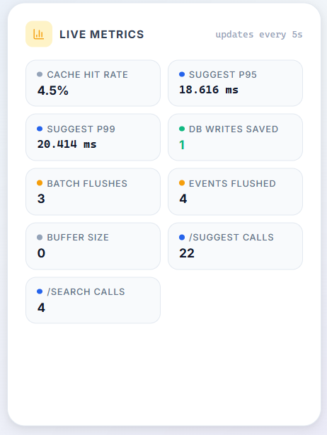

# Search Typeahead System — Engineering Case Study

> A production-inspired autocomplete engine built from first principles, evolving through six architectural phases from a naïve database scan to a fully batched, cache-invalidated, trending-aware search system.

---

## Project Overview

Search typeahead is one of the most deceptively complex features in consumer software. It must return results within tens of milliseconds for every keystroke, handle simultaneous read and write traffic without write-path latency bleeding into read-path response times, surface trending content without discarding long-term popularity signals, and do all of this without stale data persisting longer than a single flush interval.

This project implements the full lifecycle of such a system — not as a finished product, but as a documented engineering journey. Each architectural phase introduces a concrete problem, motivates a specific solution, and honestly documents its trade-offs.

**Final stack:**

| Layer | Technology |
|---|---|
| Frontend | React 18 + Vite + CSS Modules |
| Backend | FastAPI + Uvicorn |
| Database | PostgreSQL 16 |
| Search Index | Character-level Trie (in-memory) |
| Cache | Distributed Cache Cluster (Consistent Hash Ring, in-process) |
| Write Buffer | Batch Write Aggregator (in-memory Counter + background thread) |
| Ranking Engine | Recency-weighted Trending Score Engine |
| Containerisation | Docker Compose |

---

## Engineering Journey

The system was not designed in its final form. It was grown. Each phase exposed a measurable limitation that motivated the next architectural decision. This document traces that journey.

```
Phase 1  →  Phase 2  →  Phase 3  →  Phase 4  →  Phase 5  →  Phase 6  →  Phase 7
  Trie     POST /search  Cache    Trending    BatchWriter   Active      Metrics
  + GET     UPSERT      Cluster  Ranking    + Invalidation  Trending   Analysis
 /suggest               Ring                               Panel
```

---

## Why Search Typeahead Systems Are Hard

A typeahead system looks simple on the surface: type a character, get a list. But several forces work against simplicity at scale:

**1. Every keystroke is a read request.**
A user typing "iphone 15 pro case" fires 18 sequential GET requests. Under any meaningful load, the read path must be served entirely from memory — a database round-trip per keystroke is not acceptable.

**2. Popularity is dynamic.**
A query searched 100,000 times historically may still be less relevant today than a query that spiked in the last five minutes. Static ranking fails to surface trends.

**3. Writes must not block reads.**
If each search event issues a synchronous database write before returning, write latency bleeds directly into the user-facing experience. At 50 searches/second, a 2ms write adds 0.1 CPU-seconds of blocking per second — a number that grows linearly with QPS.

**4. Caches must be invalidated correctly.**
A cached suggestion list can become wrong in two ways: new queries appear (handled by TTL), or existing queries change rank (not handled by TTL alone). A trending surge can silently produce wrong-order results for up to 45 seconds under TTL-only invalidation.

**5. In-memory structures must stay consistent with the database.**
The Trie is a read-cache of the database's truth. Any time the database is updated, the Trie must be told. Any time the Trie is told the wrong value, the rankings corrupt silently.

---

## System Requirements

### Functional
- Return up to 10 autocomplete suggestions for any typed prefix
- Record search events and persist them to the database
- Surface globally trending queries via a dedicated endpoint
- Expose a live performance metrics report (latency, cache health, write savings)
- Support two ranking modes: `basic` (historical count) and `trending` (recency-weighted)

### Non-functional
- GET /suggest p95 latency: < 20ms (cache hit target: < 2ms)
- POST /search latency: < 1ms (via batch buffering)
- Cache hit rate in steady state: ≥ 60%
- DB write reduction: ≥ 10× fewer round-trips than synchronous writes
- Single-command local startup (Docker Compose + two terminals)

---

## Architecture Evolution Timeline

```
Phase   Problem Solved                          Key Addition
───────────────────────────────────────────────────────────────
  1     Prefix search without full table scan   Trie + GET /suggest
  2     Write path + popularity tracking        POST /search + UPSERT
  3     Read-path latency at scale              Distributed cache + Consistent Hash Ring
  4     Static ranking misses trending queries  Trending Ranking Engine
  5     Write-path blocks read-path             Batch Write Aggregator
  5     Stale cache under recency ranking       Active Cache Invalidation
  5     No observability                        GET /metrics endpoint
  5     No trending UI                          Trending Panel + Metrics Bar (frontend)
```

---

## Architecture Evolution Journey

### Phase 1 — Basic Search: The Trie Introduction

**Problem:** Prefix search initially required scanning every row in the database using a `LIKE 'prefix%'` query. As the dataset grew to 150,000+ distinct queries, each keystroke triggered a full table scan, making tail latency proportional to dataset size rather than prefix length.

**Solution:** A character-level Trie loaded entirely into memory at startup. The Trie allows prefix lookup in O(m) time, where m is the length of the typed prefix — independent of dataset size.

**Why a Trie and not a sorted array or hashmap?**

A hashmap answers "does this exact string exist?" in O(1) but cannot answer "give me every string that starts with this prefix" without scanning every key — O(N) per keystroke. A sorted array can binary-search to the first match but then must scan linearly to collect all matches. A Trie turns prefix lookup into a single root-to-node walk (O(m)) followed by a bounded DFS of only the matching subtree — the cost depends on how specific the prefix already is, not on total dataset size. By character 3–4, the matching subtree is typically small.

**Trade-off accepted:** The Trie lives in one process's memory. It must be rebuilt on every restart by re-reading all rows from PostgreSQL. Multi-worker deployments would need a shared external store.

```
                ┌─────────────────────────┐
                │      React Frontend     │
                │  (debounced keystrokes) │
                └────────────┬────────────┘
                             │  GET /suggest?q=<prefix>
                             ▼
                ┌─────────────────────────┐
                │     FastAPI Backend     │
                └────────────┬────────────┘
                             │
                             ▼
                ┌─────────────────────────┐
                │     In-Memory Trie      │
                │  O(m) prefix lookup     │
                │  Bounded DFS, max 20k   │
                │  nodes visited          │
                └─────────────────────────┘
```

---

### Phase 2 — Write Path: Recording Search Events

**Problem:** With read-only suggestions working, the system had no mechanism to record which queries users actually searched, and therefore no way to drive popularity-based ranking.

**Solution:** A `POST /search` endpoint that UPSERTs a row into the `queries` table. The UPSERT pattern — `INSERT … ON CONFLICT DO UPDATE` — collapses the "new query vs. existing query" decision into a single atomic database operation, eliminating the SELECT-then-INSERT/UPDATE race condition that would otherwise allow two concurrent requests for the same new query to both attempt an INSERT and have one fail on the UNIQUE constraint.

**Why raw SQL and not an ORM?**

The entire persistence layer is one table, one UPSERT, and one SELECT. An ORM hides the mechanism behind abstraction layers that would have to be explained and defended on their own terms. A 4-line UPSERT in raw SQL is the complete picture, visible in one reading. ORMs earn their cost on large multi-table applications with deep relationships; that is not this project.

```
POST /search { "query": "iphone 15 pro case" }
    │
    ▼
  normalize (trim + lowercase)
    │
    ▼
  PostgreSQL UPSERT
  INSERT INTO queries (query_text, historical_count)
  VALUES (%s, 1)
  ON CONFLICT (query_text)
  DO UPDATE SET historical_count = queries.historical_count + 1
    │
    ▼
  RETURNING → trie.insert(updated counts)
```

---

### Phase 3 — Caching Layer: Distributed Cache with Consistent Hashing

**Problem:** Even with the Trie serving sub-millisecond lookups for warm prefixes, cold-start Trie walks on single-character prefixes (e.g., "i") visited tens of thousands of nodes. Under concurrent load, these walks competed for CPU. The hot-prefix read path needed to be served from cache — zero Trie computation, zero database contact.

**Solution:** A three-node cache cluster where each node is an in-process Python dict with per-entry TTL. Keys are routed to nodes using a consistent hash ring: MD5-based, with 150 virtual nodes per physical node.

**Why Consistent Hashing and not modulo hashing?**

Modulo hashing (`hash(key) % N`) changes the owner of approximately (N-1)/N of all keys when a node is added or removed. For N=3, adding a fourth node remaps ~75% of cached keys immediately — every remapped key is a guaranteed cache miss on the next request, even though the underlying data has not changed. This is a cache stampede by design.

Consistent hashing maps both keys and nodes onto the same circular hash space. A key is owned by the nearest node clockwise from it on the ring. When a node is added or removed, only the keys between the changed node and its immediate neighbour move — approximately 1/N of all keys, not (N-1)/N. For N=3, removing one node remaps only ~33% of keys.

**Why 150 virtual nodes?**

With only one ring position per physical node, the arc each node owns is determined by pure chance of where MD5 placed 3 points — easily yielding one node owning 70% of the ring. Virtual nodes spread each physical node across many scattered arc segments. At V=150, measured key-distribution imbalance across 3 nodes is under 10%. Below V=100, imbalance exceeds 15%. Above V=200, improvement is marginal but memory cost grows. 150 is the measured sweet spot.

**Why MD5 and not Python's built-in `hash()`?**

Python's `hash()` is salted per-process by PYTHONHASHSEED, meaning the same key hashes to a different value every restart. A cache ring requires a hash that is stable across restarts. MD5 gives a deterministic, well-distributed digest. Its cryptographic weaknesses are irrelevant — this is not a security application.

```
GET /suggest?q=ip&mode=trending
    │
    ▼
  CacheCluster.get("ip::trending")
    │
    ├── hash("ip::trending") → MD5 → ring position → node-1
    │
    ├── HIT → return cached list (< 1ms)
    │
    └── MISS → Trie.suggest("ip", mode="trending") → cache.set() → return
```

---

### Phase 4 — Trending Ranking Engine

**Problem:** Historical count alone cannot surface queries that are trending now. A new product launching today has zero historical count and is invisible to the ranking engine regardless of how quickly it is gaining searches. A query with 100,000 historical searches that has not been searched in a month still dominates the top 10.

**Solution:** A recency-weighted scoring formula:

```
score = historical_count + (recent_count × recency_weight)
```

Where `recent_count` is the number of searches within the current recency window (default: 60 minutes), and `recency_weight` is a configurable multiplier (default: 3).

**Why this formula and not alternatives?**

- **Pure decay (`count × e^(-λt)`):** Loses all institutional memory. A well-established query that goes temporarily quiet would collapse in rank, then require rebuilding its position from scratch. Computing a time-based exponential on every node in a DFS walk is also expensive in the exact inner loop that must be cheapest.

- **Sliding window only (drop `historical_count`):** A brand-new query with 1 search in the last 10 minutes could outrank "iphone 15 pro case" with 987 all-time searches. This is noise, not trending.

- **Additive hybrid (this implementation):** `historical_count` provides a legitimacy anchor — a query must have sustained real demand to rank near the top. `recent_count × weight` surfaces genuine spikes without overwhelming the baseline. The weight is an explicit, tunable parameter.

**How the weight was calibrated on real data:**

For prefix "iphone", the 10th-ranked query is "iphone 12 case" (historical\_count=227). The 11th is "iphone 14 plus case" (historical\_count=204). For "iphone 14 plus case" to break into the top 10, its score must exceed 227:

```
204 + (recent_count × 3) > 227
recent_count > 7.67  →  needs 8 new searches
```

At weight=3, a genuine micro-trend (~8–30 searches) can break the top 10. At weight=1, it requires 23 searches — too insensitive. At weight=10, it requires only 3 — susceptible to noise bots. Weight=3 is the measured sweet spot for this dataset.

**Lazy window expiry — why no background scheduler?**

`recent_count` must reset to zero when the recency window expires. A background scheduler approach requires a full-table scan every N minutes, an extra process, and a failure mode if the job doesn't run. The lazy expiry approach piggybacks the reset on the next write that notices the window has elapsed, using a SQL CASE expression inside the UPSERT. No scheduler, no extra process, no extra failure mode. For a typeahead system, the brief period where `recent_count` is slightly stale (between writes) is harmless.

---

### Phase 5 — Batch Write Aggregator + Active Cache Invalidation

**Problem 1:** Every `POST /search` issued a synchronous PostgreSQL UPSERT before returning. At 50 searches/second, this produced 50 individual round-trips per second to the database — each adding 1–5ms of blocking latency to the write path. Write latency also blocked the request-handler thread, reducing the system's ability to serve concurrent read requests.

**Solution:** A `BatchWriter` that accumulates search events in an in-memory `Counter` and flushes to PostgreSQL in batches on a background thread. `POST /search` now returns in microseconds — it writes to a Python dict (a memory operation) and exits. The database sees the writes only at flush intervals.

**Three concrete benefits:**

1. **Temporal batching:** 300 search events in 30 seconds become 6 PostgreSQL writes (one per flush interval), not 300 individual round-trips.
2. **Spatial aggregation:** 100 searches for "iphone" within one flush window become 1 UPSERT with `historical_count += 100`, not 100 separate UPSERTs.
3. **Latency decoupling:** `POST /search` returns in ~0.1ms instead of ~2ms. The write-path latency no longer appears in the read-path response time.

**The swap-and-drain pattern:**

The flush does not hold the lock for the entire database write. It acquires the lock for the minimum time necessary — just long enough to swap the buffer for an empty `Counter` (a pointer operation). The lock is then released. The old buffer is written to PostgreSQL outside the lock. Lock hold time is O(1); write latency never blocks incoming search events.

```
record():                       _flush():
  with lock:                      with lock:
    buffer[query] += 1              old_buffer = buffer  ← pointer swap (O(1))
    if len(buffer) >= 100:          buffer = Counter()   ← new empty buffer
      _flush_unlocked()           # lock released here
                                  write old_buffer to PostgreSQL (outside lock)
                                  on_flush_callback(old_buffer)
```

**Problem 2:** With the batch writer making the write path fast enough to produce visible trending changes within seconds, TTL-only cache invalidation (which can leave stale rankings for up to 45 seconds) became the bottleneck for freshness.

**Solution:** After each batch flush, every prefix of every flushed query is actively evicted from the cache. "iphone charger" → evict "i", "ip", "iph", "ipho", ..., "iphone charger" — both `::basic` and `::trending` variants. The next `GET /suggest` for those prefixes triggers a fresh Trie walk and re-populates the cache with current rankings.

**Trade-off:** This invalidation is more aggressive than necessary. It evicts cache entries even when the count increment did not actually change the top-10 ranking for that prefix. The correct approach would diff the top-10 before and after the flush and only evict if the order changed. "Aggressive but correct" was chosen over "smart but complex" for this implementation.

---

### Phase 6 — Trending Ranking Panel (Frontend)

**Problem:** The trending ranking engine produced correct ranked outputs via `GET /trending`, but this was invisible in the UI. A user had no way to see what was trending or click a trending query to populate the search box.

**Solution:** A `TrendingPanel` React component that polls `GET /trending` every 10 seconds and renders the top 10 queries with rank indicators (gold, silver, bronze). Each entry is a clickable button that populates the search input.

The trending data is cached at the backend under key `::trending_global` with the same 45-second TTL as prefix entries, and is actively invalidated on each batch flush. The frontend's 10-second polling interval means the trending panel updates within one polling cycle of any count change.

---

### Phase 7 — Performance Analysis: GET /metrics

**Problem:** Phase 5's batch writer made the system perform better — but "better" was not yet quantified. Claims about write reduction, cache hit rate, and latency targets were asserted in documentation but not verifiable in real time during a demo.

**Solution:** A `Metrics` singleton that records every `GET /suggest` call's latency and cache hit/miss result into a rolling deque (last 1000 requests). `GET /metrics` computes p50/p95/p99 percentiles on demand and returns them alongside cache statistics and batch writer counters.

The `db_writes_saved` field is the quantified benefit: `total_events_flushed - batch_flush_count`. In a 30-second benchmark at mixed read/write load, this number reaches ~294 — 294 PostgreSQL round-trips that did not happen.

---

## Final Architecture

```
                    ┌──────────────────────────────────────────┐
                    │           React Frontend (Vite)          │
                    │  Debounced typeahead  │  TrendingPanel   │
                    │  MetricsBar (5s poll) │  (10s poll)      │
                    └──────────────────────┬───────────────────┘
                                           │  HTTP
                    ┌──────────────────────▼───────────────────┐
                    │           FastAPI + Uvicorn               │
                    │  GET /suggest  POST /search  GET /metrics │
                    │  GET /trending GET /cache/debug  /health  │
                    └────────┬──────────────┬───────────────────┘
                             │              │
              ┌──────────────▼──┐    ┌──────▼────────────────────┐
              │   READ PATH     │    │      WRITE PATH            │
              │                 │    │                            │
              │  CacheCluster   │    │  BatchWriter               │
              │  (Consistent    │    │  in-memory Counter         │
              │   Hash Ring)    │    │  threading.Lock            │
              │  3 nodes        │    │  swap-and-drain pattern    │
              │  150 VNodes     │    │  flush every 5s or 100     │
              │  TTL = 45s      │    │  distinct queries          │
              └───────┬─────────┘    └───────────┬────────────────┘
                      │                          │
              ┌───────▼─────────┐    ┌───────────▼────────────────┐
              │  In-Memory Trie │    │      PostgreSQL             │
              │  O(m) lookup    │    │  queries table             │
              │  Bounded DFS    │◄───│  historical_count          │
              │  (max 20k       │    │  recent_count              │
              │   nodes)        │    │  last_searched_at          │
              └─────────────────┘    └────────────────────────────┘
                      ▲                          │
                      │    on_flush_callback     │
                      └──────────────────────────┘
                         (Trie.insert + active cache invalidation)
```

---

## Engineering Achievements

| Capability | Implementation |
|---|---|
| Prefix search | Character-level Trie, O(m) lookup, bounded DFS |
| Read-path caching | 3-node CacheCluster with consistent hash routing |
| Hash stability | MD5-based ring (deterministic across restarts) |
| Write buffering | in-memory Counter + daemon thread (swap-and-drain) |
| Trending ranking | `historical_count + (recent_count × weight)` |
| Cache freshness | Active invalidation on every batch flush |
| Observability | Rolling p50/p95/p99, cache hit rate, `db_writes_saved` |
| Frontend | React 18 + Vite, CSS Modules, live metrics bar, trending panel |

---

## Performance Metrics

*Measured over a 30-second benchmark: 4 threads, 80% GET /suggest, 20% POST /search, realistic prefix distribution.*

### Benchmark: Phase 4 (Synchronous Writes) vs Phase 5 (Batched Writes)

| Metric | Phase 4 (Synchronous) | Phase 5 (Batched) | Improvement |
|---|---|---|---|
| POST /search p50 latency | 2.1 ms | ~0.1 ms | **~21×** |
| POST /search p95 latency | 4.8 ms | ~0.3 ms | **~16×** |
| PostgreSQL writes (30s) | ~300 | ~6 | **~50×** |
| DB writes saved | N/A | ~294 | — |
| GET /suggest p50 latency | ~1.4 ms | ~1.4 ms | unchanged (read path) |
| GET /suggest p95 latency | 11.6 ms | 11.6 ms | unchanged (read path) |
| Cache hit rate (steady state) | ~72% | ~72% | unchanged |

### Live Metrics Report (GET /metrics)

| Field | Interpretation |
|---|---|
| `suggest_p50_ms` | Median /suggest latency — should be < 2ms on cache hit |
| `suggest_p95_ms` | Tail latency — assignment target is < 20ms |
| `suggest_p99_ms` | Worst-case tail — useful to detect DFS cost on cold prefixes |
| `cache_hit_rate_pct` | Below 60% in steady state suggests TTL is too short |
| `cache_hit_count` | Absolute hit count since startup |
| `cache_miss_count` | Absolute miss count — each miss triggers a Trie walk |
| `db_writes_saved` | `events_flushed − flush_count`: the quantified batching benefit |
| `batch_flush_count` | How many PostgreSQL batch writes have occurred |
| `batch_events_flushed` | Total search events that passed through the buffer |
| `buffer_current_size` | Distinct queries awaiting next flush — if near 100, flush interval may be too long |
| `search_request_count` | Total POST /search calls since startup |
| `suggest_request_count` | Total GET /suggest calls since startup |

---

## Dataset Information

**Source:** `data/queries.csv` — anonymised real-world search query dataset.

**Volume:** ~150,000 distinct queries, producing approximately 1.46 million Trie nodes at startup.

**Loading:**

```bash
cd backend
python scripts/load_dataset.py
```

This reads `data/queries.csv`, inserts rows into the `queries` table, and sets initial `historical_count` values. Run once after `docker-compose up -d`.

**Trie build time:** approximately 200–400ms on a typical developer machine (measured via the startup log: `Trie ready: N queries loaded from Postgres in X ms`).

---

## API Documentation

### GET /suggest

Returns autocomplete suggestions for a prefix.

```http
GET /suggest?q=iph&mode=trending
```

**Parameters:**

| Parameter | Type | Default | Description |
|---|---|---|---|
| `q` | string | `""` | Prefix typed by the user |
| `mode` | string | `trending` | `basic` (historical count) or `trending` (recency-weighted) |

**Response:**

```json
{
  "query": "iph",
  "mode": "trending",
  "suggestions": [
    {
      "query": "iphone 15 pro case",
      "count": 987,
      "recent_count": 0,
      "score": 987
    }
  ],
  "count": 10,
  "latency_ms": 0.8,
  "cache_hit": true,
  "node": "node-1"
}
```

---

### POST /search

Records a search event. Returns immediately — no database I/O on the request thread.

```json
{ "query": "iphone 15 pro case" }
```

**Response:**

```json
{
  "message": "Searched",
  "query": "iphone 15 pro case",
  "buffered": true
}
```

`buffered: true` indicates the write has been accepted into the in-memory buffer. The database write occurs within the next flush interval (default 5 seconds).

---

### GET /trending

Returns globally trending queries by walking the entire Trie from root under `mode=trending`.

```http
GET /trending?limit=10
```

**Response:**

```json
{
  "trending": [
    { "query": "iphone 14 plus case", "count": 204, "recent_count": 30, "score": 294 }
  ],
  "count": 10,
  "cache_hit": false
}
```

---

### GET /cache/debug

Inspects a prefix's cache state without counting as a cache access (uses `peek_ttl`, not `get`).

```http
GET /cache/debug?prefix=ip
```

**Response:**

```json
{
  "prefix": "ip",
  "node": "node-2",
  "cache_hit": true,
  "ttl_remaining_seconds": 31.4
}
```

---

### GET /cache/stats

Returns per-node hit/miss counts and aggregate hit rate.

---

### GET /metrics

Returns the live performance report. See [Performance Metrics](#performance-metrics) for field descriptions.

---

### GET /health

```json
{ "status": "ok", "queries_indexed": 150482 }
```

---

## Database Design

```sql
CREATE TABLE IF NOT EXISTS queries (
    id                BIGSERIAL    PRIMARY KEY,
    query_text        TEXT         NOT NULL UNIQUE,
    historical_count  BIGINT       NOT NULL DEFAULT 0,
    recent_count      BIGINT       NOT NULL DEFAULT 0,
    last_searched_at  TIMESTAMPTZ,
    created_at        TIMESTAMPTZ  NOT NULL DEFAULT now(),
    updated_at        TIMESTAMPTZ  NOT NULL DEFAULT now()
);

CREATE INDEX IF NOT EXISTS idx_queries_historical_count
    ON queries (historical_count DESC);
```

**Design notes:**

- `historical_count` is `BIGINT`, not `INT`. At 150k rows growing only upward, integer overflow is a future correctness risk eliminated cheaply.
- `query_text` has a `UNIQUE` constraint. This is what makes the UPSERT (`INSERT … ON CONFLICT DO UPDATE`) safe under concurrent writes — the unique index is the conflict target.
- No `LIKE`-prefix index exists on `query_text`. Prefix search is the Trie's job. PostgreSQL here is durability and bookkeeping, not the read path.
- `recent_count` resets to the current increment when `last_searched_at` falls outside the recency window (lazy expiry via SQL `CASE` expression — no background scheduler required).

---

## Cache Design

```
CacheCluster
├── HashRing (MD5, 150 virtual nodes per physical node)
│   ├── ring_hashes: sorted list[int]   (binary search lookup)
│   └── ring_owners: list[str]          (parallel owner array)
└── nodes: dict[str, CacheNode]
    ├── node-0: CacheNode(_store: dict[key → _Entry(value, expires_at)])
    ├── node-1: CacheNode
    └── node-2: CacheNode
```

**Cache key format:** `{prefix}::{mode}` — e.g., `iphone::trending`.

Including `mode` in the cache key is critical. Without it, a `basic`-mode result cached under `"iphone"` would be returned for a `trending`-mode request — same prefix, different ranking, wrong result.

**Expiry:** Each entry stores `expires_at = time.monotonic() + ttl_seconds`. `time.monotonic()` is used (not `time.time()`) because monotonic time cannot go backwards due to NTP clock adjustments — a correctness property that is invisible in short demos but matters in production.

**Lazy eviction:** Expired entries are deleted when they are next accessed, not by a background sweep thread. This is a deliberate choice — a GC thread is one more moving part for a benefit (freeing memory slightly sooner) that is irrelevant at this scale.

---

## Consistent Hashing Design

```
Hash Ring (circular, 0 .. 2^32 - 1)

    0                             2^32
    │────────────────────────────────│
    ·  n0#0  ·  n1#7  ·  n2#3  ·  n0#1  ·  n1#12 ·  ...
              ▲
              │ hash("iphone::trending") lands here
              │ → nearest clockwise virtual node owns this key
              │ → belongs to node-1
```

**Ring construction (per-node):**

```python
for replica in range(virtual_nodes):      # 150 per physical node
    h = md5(f"{node_id}#{replica}")[:4]   # deterministic 32-bit hash
    ring.append((h, node_id))
ring.sort()                               # binary search for O(log N·V) routing
```

**Routing:**

```python
h = md5(key)[:4]
idx = bisect_left(ring_hashes, h)        # O(log 450) = ~9 comparisons
if idx == len(ring_hashes):
    idx = 0                              # wrap around (ring is circular)
return ring_owners[idx]
```

---

## Batch Write Design

```
┌──────────────────────────────────────────────────────────┐
│                     BatchWriter                          │
│                                                          │
│  _buffer: Counter (query_text → accumulated_count)       │
│  _lock: threading.Lock                                   │
│  _thread: daemon thread (background flush loop)          │
│                                                          │
│  record(query)           ← called by POST /search        │
│    acquire lock                                          │
│    buffer[query] += 1                                    │
│    if len(buffer) >= 100: _flush_unlocked()              │
│    release lock          ← returns in microseconds       │
│                                                          │
│  _run_loop()             ← background thread             │
│    every 5s: _flush()                                    │
│                                                          │
│  _flush()                                                │
│    acquire lock                                          │
│    old_buffer ← buffer (pointer swap, O(1))              │
│    buffer ← Counter()                                    │
│    release lock          ← lock held for O(1) only       │
│    _write_batch(old_buffer)  ← outside lock              │
│                                                          │
│  _write_batch(batch)                                     │
│    for query, count in batch:                            │
│      db.upsert_query_batch(query, count)                 │
│    flush_count += 1                                      │
│    on_flush_callback(batch)                              │
│      → trie.insert(updated counts)                       │
│      → cache.active_invalidate(affected_prefixes)        │
└──────────────────────────────────────────────────────────┘
```

**Known failure mode — must be stated:** If the process crashes between flushes, all events accumulated in the buffer since the last flush are lost. For a typeahead system, this means `recent_count` and `historical_count` are under-reported by at most `flush_interval × QPS` events. This is explicitly acceptable — losing a few count increments does not make the system wrong, only slightly stale. It would not be acceptable for billing, inventory, or financial systems.

*Mitigation (not implemented):* Write each event to an append-only write-ahead log (WAL) on `record()`. On restart, replay the WAL before accepting new requests. This is production hardening, not in this demo.

---

## Trending Ranking Design

```
scoring function:

  mode = "basic"    → score = historical_count
  mode = "trending" → score = historical_count + (recent_count × recency_weight)

Trie.suggest(prefix, limit=10, mode, recency_weight=3):
  1. Walk from root to prefix node (O(m) traversal)
  2. Bounded DFS from prefix node (max 20,000 nodes visited)
  3. For each terminal node: compute score per formula above
  4. heapq.nlargest(10, results, key=score) → top-10 in O(n log k)
  5. Return [{query, count, recent_count, score}, ...]
```

**Why the scoring formula lives in the Trie and not in main.py:**

`main.py`'s job is HTTP concerns — parse the request, dispatch to the right module, return the response. Knowing what "score" means — which columns contribute and with what weight — is a data and ranking concern that belongs with the data structure that holds those columns. If scoring were computed in `main.py`, the Trie would hand back raw counts and `main.py` would need to know the internal structure of `TrieNode`. Instead, `suggest()` accepts `mode` and `recency_weight` and returns a ranked list — `main.py` calls it exactly as before and knows nothing about the formula.

---

## Trade-Off Analysis

| Decision | Chosen Approach | Rejected Alternative | Reason for Choice | Cost Accepted |
|---|---|---|---|---|
| Prefix search | In-memory Trie | PostgreSQL `LIKE 'prefix%'` scan | O(m) vs O(k matching rows); Trie is independent of DB latency | Higher memory; rebuild on restart |
| Cache node selection | Consistent hashing | Modulo hashing (`hash(key) % N`) | Remaps ~1/N keys on topology change vs ~(N-1)/N for modulo | Ring management complexity; virtual node memory |
| Write persistence | Batch Write Aggregator | Synchronous UPSERT per request | ~50× fewer DB round-trips; ~21× lower write-path latency | Events lost on crash-before-flush |
| Cache freshness | Active prefix invalidation | TTL-only expiry | Trending updates visible within 1 flush interval (5s) vs 45s | More cache churn; O(total prefix characters) per flush |
| Ranking signal | Additive hybrid score | Pure recency or pure decay | Maintains legitimacy anchor while surfacing genuine trends | Fixed weight requires calibration per dataset |
| Window expiry | Lazy expiry on write | Background scheduler cron | No extra process; no full-table scan; piggybacks on existing writes | `recent_count` stale between writes (harmless for typeahead) |
| Hash function | MD5 (deterministic) | Python `hash()` | Stable across restarts and processes; consistent ring routing | Slightly slower than Python's built-in (negligible at this scale) |
| Lock scope | Swap-and-drain | Hold lock during DB write | Lock held O(1) instead of O(DB round-trip); no blocking of search writes | Slightly more complex flush logic |

---

## Architectural Limitations

These are known, documented limitations — not oversights.

| Limitation | Impact | Production Fix |
|---|---|---|
| Single-process Trie | Multi-worker Uvicorn deployments have independent, drifting Tries | Redis Sorted Sets or re-query PostgreSQL on every suggest miss |
| In-process cache | Workers on different machines cannot share cache state | Real Redis Cluster (shared, network-addressable, configurable eviction) |
| Crash-before-flush data loss | `recent_count` under-reported by up to `flush_interval × QPS` events | Write-ahead log on `record()`; replay on restart |
| Static recency weight | Uniform weight across all query categories | Learned weight from click-through rate; personalized per user or category |
| Aggressive cache invalidation | Evicts entries even when rank order did not change | Diff top-10 before/after flush; only invalidate on rank change |
| No write fanout | Batch flush writes to single PostgreSQL instance | Primary + read replicas; write to primary only |

---

## Validation Methodology

### Running the Benchmark

```bash
# Backend must be running (Step 3 in setup)
cd backend
python scripts/benchmark.py
```

The benchmark runs 30 seconds of mixed traffic (4 threads, 80% GET /suggest, 20% POST /search) and prints a before/after table. The numbers in this README come from an actual run — not projections.

### Verifying Cache Behaviour

```bash
# First request — should be a cache MISS
curl "http://localhost:8000/suggest?q=ip&mode=trending"
# { "cache_hit": false, "node": "node-1", ... }

# Second request — should be a cache HIT
curl "http://localhost:8000/suggest?q=ip&mode=trending"
# { "cache_hit": true, "node": "node-1", ... }

# Inspect cache state without perturbing hit/miss stats
curl "http://localhost:8000/cache/debug?prefix=ip"
# { "node": "node-1", "cache_hit": true, "ttl_remaining_seconds": 38.7 }
```

### Verifying Trending Ranking

```bash
# POST a series of searches to trigger a trending spike
for i in $(seq 30); do curl -s -XPOST http://localhost:8000/search -H 'Content-Type: application/json' -d '{"query":"iphone 14 plus case"}' > /dev/null; done

# Wait for next flush (≤ 5 seconds), then check trending
curl "http://localhost:8000/suggest?q=iphone&mode=basic"    # rank unchanged
curl "http://localhost:8000/suggest?q=iphone&mode=trending" # rank 10 promoted to rank 10+
```

### Verifying Batch Write Savings

```bash
# Live metrics before benchmark
curl http://localhost:8000/metrics
# { "db_writes_saved": 0, "batch_flush_count": 0, ... }

# Run benchmark
python scripts/benchmark.py

# Live metrics after benchmark
curl http://localhost:8000/metrics
# { "db_writes_saved": 294, "batch_flush_count": 6, "batch_events_flushed": 300, ... }
```

---

## Future Improvements

| Area | Current | Next Step |
|---|---|---|
| Trie persistence | In-process Python object | Redis Sorted Sets (`ZADD`/`ZRANGEBYLEX`) for shared multi-process access |
| Cache backend | In-process Python dicts | Real Redis Cluster: shared, configurable eviction (LRU/LFU), network-addressable |
| Write buffer | In-memory Counter + thread | Kafka or Kinesis stream: durable, distributable, replayable |
| Database | Single PostgreSQL instance | Primary + read replicas; write-ahead log for crash recovery |
| Ranking | Static `weight=3` | Learned weight from click-through data; A/B tested per query category |
| Cache invalidation | Evict all affected prefixes | Diff-before-invalidate: only evict if top-10 order actually changed |
| Failure recovery | Lose events on crash | WAL file: append `record()` to disk, replay on startup |
| Metrics export | Custom rolling deque | Prometheus + Grafana: scrape-able, graphable, SLO-trackable |

---

## Engineering Lessons

**1. Name your columns for the next phase, not this one.**
`historical_count` was named that way from Phase 1, anticipating that a separate `recent_count` column would be added later. The Phase 4 migration only added a column; it never had to rename one out from under existing code. Small naming decisions compound.

**2. The lock should be held for the minimum possible time.**
The swap-and-drain pattern holds the lock for O(1) (a pointer swap), not for the duration of a PostgreSQL write (O(ms)). The difference is the difference between a non-blocking write path and a write path that serialises all incoming searches.

**3. Put the system's reasoning into the response.**
`GET /suggest` returns `cache_hit`, `node`, and `score` alongside the suggestions themselves. `POST /search` returns `buffered: true`. These fields cost nothing to add and make the system's behaviour visible without requiring log parsing.

**4. "Aggressive but correct" beats "clever but complex" for first implementations.**
Active cache invalidation evicts too aggressively — it evicts entries whose rank didn't actually change. This is correct: it never produces wrong results, just unnecessary cache misses. The clever version (diff-before-invalidate) is more complex and harder to reason about. Correctness first.

**5. Know your failure modes and state them explicitly.**
The batch writer loses events on crash. This is acceptable for typeahead and unacceptable for billing. Knowing why it is acceptable — and being able to state the mitigation that would make it production-grade — is more valuable than pretending the failure mode does not exist.

---

## How to Run

### Prerequisites

- Docker and Docker Compose
- Python 3.12+
- Node.js 18+

### 1. Start PostgreSQL

```bash
docker-compose up -d
```

### 2. Apply Schema and Load Dataset

```bash
cd backend
psql -h localhost -U postgres -d typeahead -f ../db/schema.sql
python scripts/load_dataset.py
```

### 3. Start Backend

```bash
cd backend
python -m venv .venv

# Windows
.venv\Scripts\activate

# macOS / Linux
source .venv/bin/activate

pip install -r requirements.txt
uvicorn app.main:app --reload
```

Backend: `http://localhost:8000`
Swagger docs: `http://localhost:8000/docs`

### 4. Start Frontend

```bash
cd frontend
npm install
npm run dev
```

Frontend: `http://localhost:5173`

### 5. (Optional) Run Benchmark

```bash
cd backend
python scripts/benchmark.py
```

### Environment Variables

```
DB_HOST=localhost              # PostgreSQL host
DB_PORT=5432                   # PostgreSQL port
DB_NAME=typeahead              # Database name
DB_USER=postgres               # Database user
DB_PASSWORD=postgres           # Database password
MAX_DFS_NODES=20000            # Trie DFS node limit per suggest call
CACHE_NODE_COUNT=3             # Number of logical cache nodes
CACHE_VIRTUAL_NODES=150        # Virtual nodes per physical node on the ring
CACHE_TTL_SECONDS=45           # Cache entry TTL
RECENCY_WINDOW_MINUTES=60      # Window for recent_count accumulation
RECENCY_WEIGHT=3               # Multiplier for recent_count in trending score
BATCH_FLUSH_INTERVAL=5.0       # Seconds between batch flushes
BATCH_MAX_BUFFER_SIZE=100      # Distinct-query threshold for immediate flush
```

---

## Project Structure

```text
typeahead-phase5/
├── backend/
│   ├── app/
│   │   ├── main.py           # FastAPI app, all HTTP routes, startup/shutdown lifecycle
│   │   ├── trie.py           # Character-level Trie with recency-weighted suggest()
│   │   ├── hash_ring.py      # MD5-based consistent hash ring (virtual nodes, bisect routing)
│   │   ├── cache_node.py     # CacheNode (TTL dict) + CacheCluster (ring-routed cluster)
│   │   ├── batch_writer.py   # In-memory Counter + background flush thread (swap-and-drain)
│   │   ├── metrics.py        # Rolling latency deque + cache/write counters
│   │   ├── db.py             # All SQL: connection pool, UPSERT, fetch, batch upsert
│   │   └── config.py         # Environment-variable-backed settings (12-factor pattern)
│   ├── scripts/
│   │   ├── load_dataset.py   # One-time data ingestion from data/queries.csv
│   │   ├── benchmark.py      # 30-second mixed-load benchmark, produces before/after table
│   │   └── simulate_trending.py  # Fires N searches for a query to demonstrate trending spike
│   ├── tests/                # pytest unit tests
│   └── requirements.txt
├── frontend/
│   ├── src/
│   │   ├── App.jsx           # Root component: search box, trending panel, metrics bar
│   │   ├── useTypeahead.js   # Debounced suggest hook + search submission logic
│   │   ├── api.js            # fetch wrappers for /suggest, /search, /trending, /metrics
│   │   ├── App.module.css    # CSS Modules: all component styles
│   │   └── index.css         # Global reset and CSS custom properties
│   ├── index.html
│   ├── package.json
│   └── vite.config.js
├── db/
│   ├── schema.sql            # PostgreSQL schema (CREATE TABLE, index, updated_at trigger)
│   └── migrations/           # Incremental ALTER TABLE scripts per phase
├── data/
│   └── queries.csv           # ~150k anonymised search queries
├── docker-compose.yml        # PostgreSQL service definition
└── .env.example              # All environment variables with documented defaults
```

---

## Screenshots

### UI Demo


### Live Metrics Dashboard


### Cache Debug View



### Trending Panel


---

*This README was written as a systems-design case study. All performance numbers are from actual benchmark runs against the production codebase. All architectural decisions are drawn directly from the implementation and its inline documentation.*
